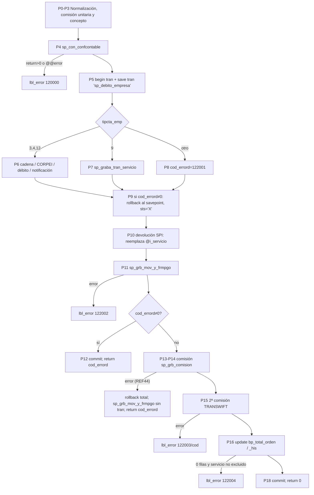

# 02 · Flujo ordenado y efectos de `sp_debcred_empresa`

Regla de este documento: **se describe lo que el código hace, en el orden en que lo hace**. Cada
llamada lleva el mapeo completo parámetro → valor. `Qxx` remite a [`03_quirks.md`](03_quirks.md).

## Vista general



---

## P0 · Inicialización y traslado de comisión (L168-196)

1. `@w_cantidad = 0`, `@w_comision_und = 0`.
2. `@w_batch`: `aplcobis='S'` → 0; `'N'` → 1; cualquier otro valor → **NULL** (Q02).
3. Si `@i_comision > 0 and @i_valor_comision = 0`: `@i_valor_comision = @i_comision` y `@i_comision = 0`.
   Si `@i_valor_comision` es NULL, **no** se traslada (Q01).

## P1 · Comisión unitaria y cantidad (L204-248)

```
exec @w_return = db_biz_admempresa..sp_con_comision
  @i_cod_empresa = @i_empresa, @i_cod_producto = @i_producto, @i_cod_servicio = @i_servicio,
  @i_cod_canal = @i_canal, @i_cod_alcance = 'E', @i_tip_comision = '01', @i_secuencia = 1,
  @i_aplcobis = @i_aplcobis, @o_valor_por_tran = @w_val_por_tran OUT
```
- `@w_return ≠ 0` → `@w_val_por_tran = 0`. **No es error.**
- `@w_comision_und = @i_comision` si > 0; luego `= @i_valor_comision` si > 0 (gana el segundo).
- Si `@w_val_por_tran > 0`: `@w_cantidad (int) = @w_comision_und / @w_val_por_tran` (Q03).
- **Siempre**: `@w_comision_und = @w_val_por_tran` (puede ser NULL si el SP devolvió 0 sin asignar la salida).

## P2 · Normalizaciones (L254-272)

`@w_moneda = convert(char(2), @i_mon_debito)` (Q04), `@o_error = 0`, `@w_act_totord = 'S'`,
`@i_frm_pagcob_deb = isnull(@i_frm_pagcob_deb, @i_frm_pagcob)`, `@s_ssn = isnull(@s_ssn,0)`,
`@w_trn = 0`, `@w_causal = ' '`.

## P3 · Concepto contable (L278-312)

| Condición | `@w_concepto_bas` | Efecto adicional |
|---|---|---|
| `@i_servicio = 'SPI'` | `@s_term` (truncado a 5) | `@s_term = ' '` (Q05) |
| otro y `@i_tipcta_emp = 12` y existe `vi_cuenta` con `vi_cta_banco=@i_numcta_emp and vi_prod_banc=13` | `'91'` | — |
| otro | `'0'` | — |

## P4 · Configuración contable (L320-394)

| Condición | Llamada |
|---|---|
| `@i_servicio='TRANSQUICK' and @i_frm_pagcob_spi is not null` | `sp_con_confcontable @i_producto, @i_servicio, @i_tipoafec=@i_tipo_afec, @i_frm_pagcob=@i_frm_pagcob_spi, @i_canal, @i_tipcta=@i_tipcta_emp, @i_moneda=@w_moneda, @i_referencia=@i_tipo_referencia, @i_empresa, @o_trn=@w_trn OUT, @o_cau=@w_causal OUT` — **sin `@i_concepto`** |
| otro | igual, pero `@i_frm_pagcob=@i_frm_pagcob` y **con** `@i_concepto=@w_concepto_bas` |

Error si `@w_return > 0 or @@error <> 0` → `@w_num_error=120000` → `lbl_error`. Un retorno **negativo no es error** (Q06).
Ojo: aún no hay `begin tran`; `lbl_error` hace `rollback tran` si `@@trancount>0`, lo que revierte la transacción **del llamador** (Q07).

## P5 · Transacción (L402-408)

`begin tran` ; `@w_savepoint = 'sp_debito_empresa'` ; `save tran @w_savepoint`.

## P6 · Ramo A: `@i_tipcta_emp in (3,4,12)` (L414-1258)

### P6.1 Referencia `@w_cadena` (L422-450)
- Por defecto `convert(varchar(10), @i_orden_empresa)`.
- `ltrim(rtrim(@i_servicio))='TRANSWIFT'` → `'COD:' + @i_cod_swift` (si `@i_cod_swift` es NULL: Q08).

### P6.2 IMPADUAN / CORPEI (L456-550)
Si el servicio es `IMPADUAN`: `@i_cod_swift = isnull(@i_cod_swift,'')`. Si además `ltrim(rtrim(@i_cod_swift))='CORPEI'`:
1. `@w_concepto='99999'`, `@w_causal=NULL`.
2. `select @w_concepto = ct_cod_catalogo` del catálogo `ad_concepto_contable` con `ct_otro_campo_catalogo='NDCORPEI'` y estado 'A' (0 filas → queda '99999'; N filas → la última, Q09).
3. Nueva llamada a `sp_con_confcontable` (rama "otro" de P4 con `@i_concepto=@w_concepto`) → **sobrescribe `@w_trn` y `@w_causal`**.
4. `@w_causal = isnull(@w_causal,'512')`.
5. Si `@w_return > 0` → 120000 → `lbl_error` (aquí no se revisa `@@error`).

### P6.3 Devolución SPI (L558-614)
Si `servicio='SPI' and @i_tipo_afec='12'`: `@w_cadena = convert(varchar(10), @i_orden_empresa)` (el mismo valor por defecto; el bloque comentado L562-610 es código muerto).

### P6.4 Nota de débito (L624-740)

**Si `@i_tipcta_emp = 12`:**
```
exec @w_return = cob_virtuales..sp_vi_ndc_automatica
  @s_srv=@s_srv, @s_ofi=0, @s_user=@s_user, @s_term=@s_term, @t_trn=@w_trn,
  @i_cta=@i_numcta_emp, @i_val=@i_valor_debito, @i_cau=@w_causal, @i_mon=@i_mon_debito,
  @i_empresa=@i_empresa, @i_canal='SAT', @i_verf_estado_cta='S', @i_batch=@w_batch,
  @i_ref=@w_cadena, @i_alt=@i_orden,
  @o_error=@w_cod_errord OUT, @o_ssn_monet=@w_tran_ncnd OUT
@w_cod_errord = @w_return            -- descarta el @o_error del sub-SP
```

**Si no (3 o 4):**
```
exec @w_return = sp_ndc_ahcc
  @s_ssn=@s_ssn, @s_srv=@s_srv, @s_user=@s_user, @s_term=@s_term, @s_ofi=0,
  @s_date=@i_fecha_proceso, @t_trn=@w_trn, @i_cuenta=@i_numcta_emp,
  @i_tipo_cuenta=@i_tipcta_emp, @i_causal=@w_causal, @i_valor=@i_valor_debito,
  @i_mon=@i_mon_debito, @i_tarjeta=@i_tarjeta, @i_servicio=@i_servicio, @i_ref=@w_cadena,
  @i_aplcobis=@i_aplcobis, @i_detalle=@i_ref_prov, @i_tcomision=@i_comision,
  @i_canal=@i_canal, @i_frm_pagcob=@i_frm_pagcob_spi,        -- ¡_spi!
  @i_alt=@i_orden, @i_alterno_dos=@i_frm_pagcob, @i_orden_banco=@i_orden,
  @i_secuencial=0, @i_nchq=@w_cantidad, @i_solca=@w_comision_und,
  @o_transaccion=@w_tran_ncnd OUT
@w_cod_errord = @w_return
```

### P6.5 Notificación (L746-1254)
Solo si `@w_return = 0 and ltrim(rtrim(@i_servicio)) <> 'PAGOPRV'`.

1. **Canal SMS**: DIR/SAT → `@w_canal_sms='SAT'`, `@w_desc_canal='SAT'`; BNK → `'IBK'`, `'24OnLine'`;
   VEN → `'VEN'`, `'Ventanilla'`; otro → canal sin cambio, `@w_desc_canal=NULL`.
2. **Servicio SMS**: `@w_serv_sms = ltrim(rtrim(substring(ct_cod_catalogo,1,patindex('%-%',ct_cod_catalogo)-1)))`
   de `ad_servicios_sms` con `ct_nom_catalogo like '%'+servicio+'%'`, `right(código,3)=@w_canal_sms`, estado 'A' (Q09, Q12).
3. Si `@w_serv_sms is null` → no notifica y no hace nada más del bloque.
4. **Datos del crédito**:
   - TRANSWIFT: `@w_emp_inst=dt_referencia_grupo`, `@w_cta_cre=substring(dt_nom_cuenta,1,30)` de
     `db_biz_pagos..bp_orden ⋈ bp_detalle` (`or_orden_banco=@i_orden`, `dt_secuencial=@i_secuencial`, `or_ordenante=@i_empresa`);
     si 0 filas, lo mismo en `db_sat_his..*_his`. `@w_valor_comision=@i_valor_comision`.
   - Otro servicio: `@w_emp_inst=NULL`, `@w_cta_cre=NULL`.
   - TRANSCLI/TARJCRED/COMEXT: **result set** `select @i_comision, @i_valor_ordenado` (Q11);
     `@w_valor_comision=@i_comision`; **`@i_valor_debito = @i_valor_ordenado`** (Q10);
     `@w_emp_inst=substring(ct_nom_catalogo,10,32)`, `@w_tip_cta=dt_tipo_cta`, `@w_cta_cre=dt_numero_cuenta`
     de `bp_detalle ⋈ ad_cuentas_bce` (`dt_referencia_grupo = substring(ct_nom_catalogo,1,9)`), fallback a `_his`;
     `@w_prodcre`: 0→NULL, 3→'CTE', 4→'AHO'.
   - Para cualquier servicio: `@w_tip_cta=9` → `'CON'`; `8` → `'ESP'`.
5. `@w_valor_comision = isnull(@w_valor_comision,0) + isnull(@i_valor2_swift,0)`;
   `@w_valor_sms = convert(varchar(11), @i_valor_debito)` (ya mutado por Q10); `@w_costo_sms = convert(varchar(11), @w_valor_comision)` (Q15).
6. `@w_serv_pago_dir = ct_otro_campo_catalogo` de `ad_notificacion_basica` con `ct_cod_catalogo=@i_servicio`; NULL → `'OTRO'`.
7. **`'B'`**: `@w_nombre_cuenta_d, @w_dt_referencia_grupo` de `bp_detalle` (base actual, solo por `dt_orden_banco`;
   si `@@rowcount=0` usa `db_sat_his..bp_detalle_his`), luego:
   ```
   exec @w_return = pa_sat_pnotificacion
     @i_canal=@i_canal, @i_ctadebito=@i_numcta_emp, @i_tipctadeb=@i_tipcta_emp, @i_servicio=@i_servicio,
     @i_orden_banco=@i_orden, @i_direccion_transf=@w_dt_referencia_grupo, @i_secuencial=@i_secuencial,
     @i_valor=@i_valor_ordenado, @i_nombrecred=@w_nombre_cuenta_d, @i_comision=@i_valor_comision,
     @i_ctacred=@w_cta_cre, @i_prod_cre=@w_prodcre, @i_empresa=@w_emp_inst,
     @o_error=@o_error OUT, @o_msg=@w_msg OUT          -- ¡escribe el @o_error del SP! (Q13)
   ```
8. **`'OTRO'`**:
   - `@w_proddeb`/`@w_ente`: tipo 3 → 'CTE' y `cc_cliente`; tipo 4 → 'AHO' y `ah_cliente`;
     tipo 12 → `vi_cliente` y `'AHO'` si `vi_prod_banc=13`, si no `'VIR'`.
   - `@w_bloqNoti='S'` si existe en `ba_bloqueaNotificacionSAT` `ct_nom_catalogo = rtrim(@i_servicio)+'-'+rtrim(@w_serv_sms)`
     y `ct_otro_campo_catalogo = rtrim(@i_sp_name)`.
   - `@v_notiBCE='S'` si `@w_canal_sms='BCE' and @i_servicio='ROLPAGO' and @i_numcta_emp is null`.
   - Si `bloqNoti<>'S'` y `notiBCE='N'`:
     ```
     exec @w_return = cob_internet..sp_eventos
       @i_operacion='I', @i_canal=@w_canal_sms, @i_servicio=@w_serv_sms, @i_producto=@i_tipcta_emp,
       @i_cuenta=@i_numcta_emp, @i_valor=@w_valor_sms, @i_cta_deb=@i_numcta_emp, @i_prod_deb=@w_proddeb,
       @i_cta_cre=@w_cta_cre, @i_prod_cre=@w_prodcre, @i_cliente=@w_ente, @i_costo=@w_costo_sms,
       @i_empresa=@w_emp_inst, @i_desc_canal=@w_desc_canal
     ```
9. Cualquier otro valor de `serv_pago_dir` → no notifica.
10. **`@w_cod_errord = @w_return`** (L1248): el resultado de la notificación **reemplaza** el resultado del débito (Q12).

## P7 · Ramo B: `@i_tipcta_emp = 9` (L1264-1306)

1. `@w_empresa_str = convert(varchar(10), @i_empresa)`.
2. Si `@w_empresa_str='1295' and @i_servicio='SPI'`: `@v_saldo_ap = @i_valor_debito`, **`@i_valor_debito = 0`** (Q17).
3. ```
   exec @w_return = db_biz_pagos..sp_graba_tran_servicio
     @s_srv=@s_srv, @s_ofi=@s_ofi, @s_ssn=null, @s_user=@s_user, @s_term=@s_term, @t_trn=@w_trn,
     @i_fecha=@i_fecha_proceso, @i_referencia=@i_ref_prov, @i_cta_banco=@i_numcta_emp,
     @i_oficina=@s_ofi, @i_indicador=1, @i_moneda=@i_mon_debito, @i_causa=@w_causal,
     @i_saldo=@v_saldo_ap, @i_valor=@i_valor_debito, @i_oficina_cta=0,
     @i_tipo_chequera=@w_empresa_str, @i_orden_banco=@i_orden, @i_secuencial=0
   @w_cod_errord = @w_return
   ```
   Sin notificación. `@w_cadena` y `@w_tran_ncnd` quedan NULL (Q18).

## P8 · Ramo C: otro tipo de cuenta (L1312-1318)

`@w_cod_errord = 122001`. No se llama a ningún débito. `@w_cadena` queda NULL.

## P9 · Reverso parcial (L1332-1342)

`@w_sts_proc='P'`; si `@w_cod_errord ≠ 0`: `rollback tran @w_savepoint` (la transacción sigue abierta) y `@w_sts_proc='X'`.

## P10 · Devolución SPI (L1348-1380)

Si `servicio='SPI' and @i_tipo_afec='12'`: `@w_serv_origen = or_servicio` de `db_biz_pagos..bp_orden` (fallback `_his`);
**`@i_servicio = @w_serv_origen`** (NULL si la orden no existe en ninguna tabla, Q14); `@w_act_totord='N'`.

## P11 · Movimiento del débito (L1394-1476)

```
exec @w_return = sp_grb_mov_y_frmpgo
  @s_user, @s_term, @s_ofi, @t_trn=@w_trn, @i_tipo_proceso, @i_empresa, @i_producto,
  @i_orden_banco=@i_orden, @i_canal, @i_cau=@w_causal, @i_est_proceso=@w_sts_proc,
  @i_cod_error=@w_cod_errord, @i_frm_pagcob=@i_frm_pagcob, @i_moneda_orden=@i_mon_debito,
  @i_valor_mov=@i_valor_debito, @i_tipo_afectacion='1', @i_fch_contab=@i_fecha_proceso,
  @i_referencia=@i_referencia, @i_secuencial=0, @i_servicio=@i_servicio,
  @i_tipo_pagcob, @i_pais_cta, @i_cod_banco_cta, @i_tipo_cta=@i_tipcta_emp,
  @i_numero_cta=@i_numcta_emp, @i_valor_ordenado, @i_nem_ordenante=@i_nem_emp,
  @i_localidad_pagcob=@i_localidad_orden, @i_nombre_cuenta=@w_nombre_cuenta,
  @i_nombre_beneficiario=@w_nombre_cuenta, @i_orden_empresa, @i_valor_comision=@i_comision,
  @i_tran_ncnd=@w_tran_ncnd
```
`@w_nombre_cuenta` **nunca se asigna** → siempre NULL (Q16). Error si `@w_return≠0 or @@error≠0` → 122002 → `lbl_error`.

## P12 · Salida por error del débito (L1480-1492)

Si `@w_cod_errord ≠ 0`: `commit tran` (persiste el movimiento 'X'), `@o_error=@w_cod_errord`, `return @o_error`.

## P13 · Mutaciones previas a la comisión (L1500-1508)

- `TRANSQUICK` y `@i_frm_pagcob_spi is not null` → `@i_frm_pagcob = @i_frm_pagcob_spi`.
- `TRANSBIMO` → `@i_valor_tarifa = @i_valor_comision`.

## P14 · Comisión (L1512-1732)

Solo si `@i_valor_comision > 0` (NULL → no entra).
```
exec @w_return = sp_grb_comision
  @s_ssn, @s_srv, @s_user, @s_term, @s_ofi, @i_aplcobis, @i_sp_name, @i_fecha_proceso,
  @i_canal_comision=@i_canal, @i_empresa, @i_producto, @i_servicio, @i_tipo_proceso,
  @i_orden_banco=@i_orden, @i_valor_comision=@i_valor_comision, @i_cadena=@w_cadena,
  @i_tarjeta, @i_frm_pagcob=@i_frm_pagcob, @i_moneda=@i_mon_debito, @i_tipcta_emp, @i_numcta_emp,
  @i_referencia='COBRO DE COMISION', @i_detalle_ref=@i_ref_prov, @i_tipo_pagcob, @i_pais_cta,
  @i_cod_banco_cta, @i_nem_ordenante=@i_nem_emp, @i_localidad_pagcob=@i_localidad_orden,
  @i_nombre_cuenta=@w_nombre_cuenta, @i_nombre_beneficiario=@w_nombre_cuenta, @i_orden_empresa,
  @i_tipo_horario=@i_tipo_referencia, @i_savepoint=@w_savepoint, @i_secuencial=0,
  @o_error=@w_cod_errord OUT, @i_valor_tarifa, @i_valor_comision_cue, @i_valor_tarifa_efe,
  @i_valor_comision_efe, @i_valor_tarifa_che, @i_valor_comision_che
```
**Error** (`@w_return≠0 or @@error≠0 or @w_cod_errord≠0`) — REF44:
1. `@w_num_error` = 122003 o `@w_cod_errord` (se calcula y **no se usa**).
2. `@w_sts_proc='X'`; si `@@trancount>0` → `rollback tran` (**todo**: incluido el débito y su movimiento 'P').
3. Fuera de transacción: `sp_grb_mov_y_frmpgo` con los mismos parámetros que P11 salvo
   `@i_est_proceso='X'`, `@i_cod_error=@w_cod_errord`, **`@i_valor_mov=@i_valor_comision`**,
   **`@i_referencia='COBRO DE COMISION'`**, `@i_frm_pagcob` ya mutado por P13. No se valida su retorno.
4. `@o_error=@w_cod_errord`; `return @o_error` (Q19).

El bloque L1716-1730 es inalcanzable (Q20).

## P15 · Segunda comisión TRANSWIFT (L1742-1856)

Si `isnull(@i_valor2_swift,0) > 0 and servicio='TRANSWIFT'`: `sp_grb_comision` con los parámetros de P14 salvo
`@i_valor_comision=@i_valor2_swift`, `@i_referencia=@i_referencia`, **`@i_tipoafec='16'`**, `@i_valor_tarifa=@i_valor2_swift`,
y **sin** los parámetros `_cue/_efe/_che`. Error → `@w_num_error` = 122003 o `@w_cod_errord` → `lbl_error` (manejo distinto al de P14, Q21).

## P16 · Estado de la orden (L1876-2070)

`set te_estado_proceso='T', te_codigo_error=@w_cod_errord` (siempre 0 a esta altura), filtrando
`te_orden_banco=@i_orden`, `te_servicio=@i_servicio` (posiblemente mutado), `isnull(te_estado_proceso,'I')='I'` y:

| Canal | `@i_opcion` | Filtro `te_frm_pagcob` |
|---|---|---|
| DIR, SFR, FR2, BTH, VEN | '01' | `in (@i_frm_pagcob_deb)` |
| DIR, SFR, FR2, BTH, VEN | '02' | `in ('CUE','EFE','CHL')` |
| DIR, SFR, FR2, BTH, VEN | '03' | `in ('CUE','EFE','CHE')` |
| DIR, SFR, FR2, BTH, VEN | otra | **no actualiza** (Q22) |
| otro canal | — | `in ('COB','TRC','CTB','CPD','TPD')` |

Primero `bp_total_orden` (base actual); si 0 filas, el mismo update en `db_sat_his..bp_total_orden_his`.
`@wRowdbBiz` = filas del último update. No se revisa `@@error`.

## P17 · Validación (L2076-2090)

Si `@wRowdbBiz = 0` y servicio ∉ (TRANSWIFT, IMPADUAN, PAGIESS, TRANSQUICK, TRANSBIMO, PAGOPRV) y `@w_act_totord='S'`
→ 122004 → `lbl_error`. Si `@wRowdbBiz` es NULL no hay error (Q22).

## P18 · Fin (L2130-2136)

`commit tran`; `@o_error = isnull(@o_error,0)`; `return 0`.

## P19 · `lbl_error` (L2140-2170)

`if @@trancount > 0 rollback tran`; `aplcobis='S'` → `exec cobis..sp_cerror @t_from=@i_sp_name, @i_num=@w_num_error`, `return @w_num_error`;
otro → `@o_error=@w_num_error`, `return 0`.

## Código muerto o sin efecto (documentado para no reimplementarlo por error)

L136, L378, L434, L466, L562-610, L620, L1392, L2098-2124 (comentarios); L1716-1730 y L1844-1854 (inalcanzables);
`@o_reg_a_proc`, `@w_nombre_cuenta`, `@w_msg` (variables sin efecto real, salvo como NULL en las llamadas).
